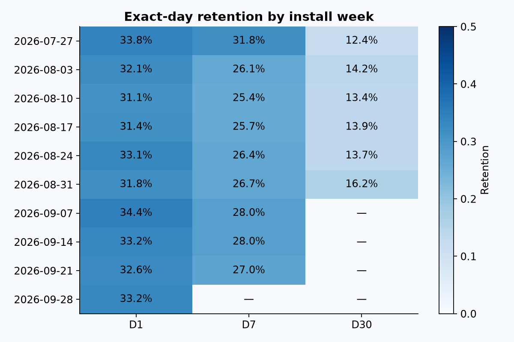

# App retention

Когортный анализ приложения: D1/D7/D30, неполные окна наблюдения и связь онбординга с удержанием.



**Результат симуляции.** 18 000 установок, 9102 зрелых наблюдений D30: 14.63% с онбордингом против 12.96% без. Причинный эффект из этого сравнения не следует.

## Запуск

Python 3.11+. Все команды из корня репозитория.

```sh
python -m venv .venv
source .venv/bin/activate
pip install -r requirements.txt
python -m analysis
pytest -q
```

Генератор сохраняет CSV в `data/`. SQL лежит в `sql/`, расчёты — в `analysis/`.
Результаты: [выводы](reports/findings.md), [метрики](reports/metrics.json) и CSV в `reports/`.
Повторный запуск перезаписывает результаты. Seed — 42; сеть и отдельный сервер БД не нужны.

## Данные

Учебная симуляция, не данные действующего продукта. Генератор: `analysis/data.py`.
Параметры сценария открыты в коде; найденные различия демонстрируют метод, а не бизнес-достижения.
Исходные строки не хранятся в Git: они полностью восстанавливаются запуском.
Для внешних данных можно передать DataFrame в функции анализа; схема описана ниже.

## Метод

Схема: `users(user_id, installed_at, channel, onboarded)`, `events(user_id, active_at)`.
Онбординг — завершение в день установки. Когорты — недели установки с понедельника.
Retention — возврат ровно на день N, не rolling retention. Повторные события одного дня дедуплицируются.
Для каждого горизонта свой знаменатель: только пользователи с полным окном к дате среза.
Свежие установки не приравниваются к оттоку. Частично зрелая неделя содержит только зрелых пользователей;
размеры знаменателей доступны в CSV. Общее удержание — отношение сумм, не среднее процентов когорт.
В генераторе есть скрытая вовлечённость: связь с онбордингом не имеет причинной интерпретации.
SQL запускается в DuckDB, не требует ClickHouse-сервера.
